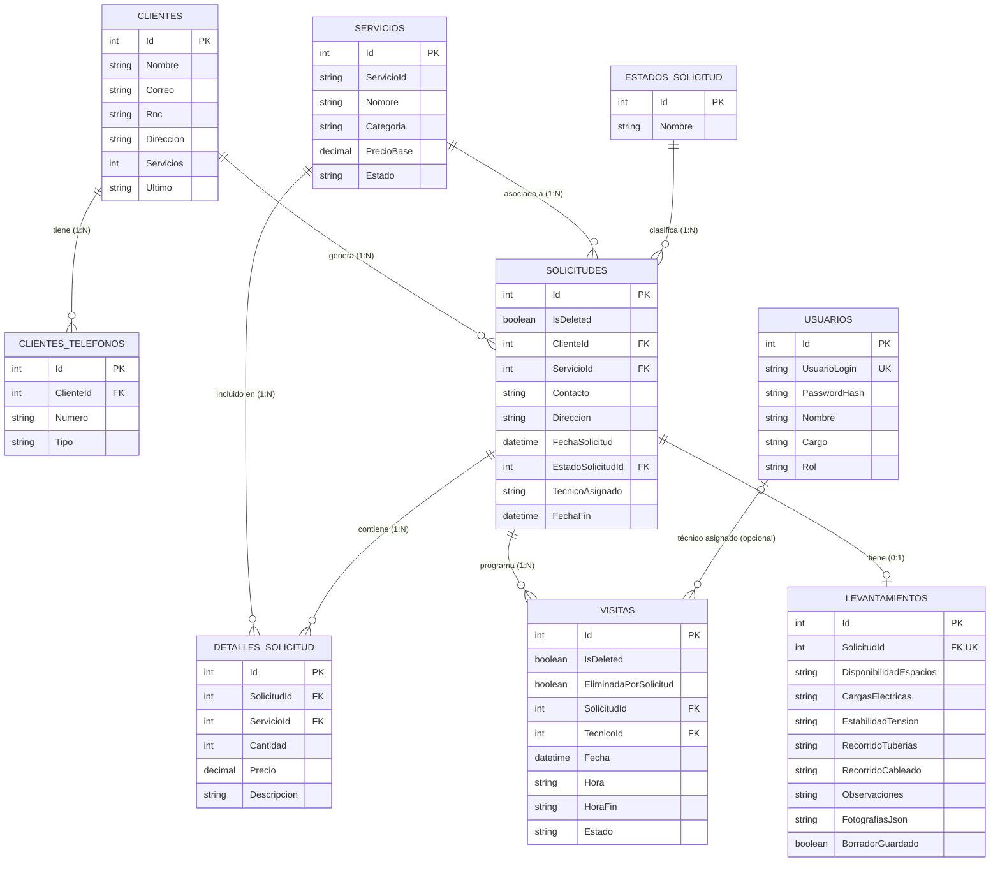

# ElectroGestion

[](https://electrogestion.runasp.net/)
[](https://dotnet.microsoft.com/)
[](https://www.microsoft.com/sql-server)

> 🚀 **Enlace Principal de Despliegue (Producción):** [https://electrogestion.runasp.net/](https://electrogestion.runasp.net/)

Sistema de gestión operativa y comercial para empresas de ingeniería eléctrica, contratistas e instalaciones de energía. Permite administrar el ciclo completo de atención: registro de clientes, catálogo de servicios, gestión de solicitudes técnicas y asignación de trabajos en campo.

---

## 🌐 Despliegue en Producción

El sistema se encuentra desplegado y plenamente operativo en la nube a través de MonsterASP.net:

- **Enlace de Producción:** [https://electrogestion.runasp.net/](https://electrogestion.runasp.net/)
- **Plataforma:** ASP.NET Core Blazor (.NET 10) Server Components
- **Base de Datos:** Microsoft SQL Server

### Credenciales de demostración

La migración crea estos usuarios para iniciar sesión. Las contraseñas se almacenan como hashes:

| Rol | Usuario | Contraseña |
| :--- | :--- | :--- |
| Gerente (Ana Hernández) | `ana` | `ana` |
| Técnico (Luis Peña) | `luis` | `luis` |
| Técnico (Carlos Méndez) | `carlos` | `carlos` |
| Administrador (Recuperación) | `admin` | `admin` |

Estas credenciales son únicamente para demostración; deben cambiarse antes de usar el sistema en producción.

---

## Sustentado por

| Nombre | Matrícula |
| :--- | :--- |
| **Jeison Amparo Abreu** | 1000-5296 |
| **Dionicio Hernández Pujols** | 1000-5331 |
| **Julymar Santos Balbi** | 1000-5890 |
| **Isaac Rosario Paulino** | 2023-0532 |
| **Williams Rafael Sanchez Acosta** | 2023-0136 |

**Carrera:** Ingeniería en Sistemas y Computación  
**Asignatura:** Proyecto Aplicado  

---

## Descripción del Proyecto

ElectroGestion centraliza las operaciones entre la administración y los técnicos de campo. Sustituye el manejo informal de órdenes de trabajo por un flujo estructurado que garantiza trazabilidad desde la primera llamada del cliente hasta la finalización del servicio.

### Roles del Sistema

- **Gerencia (Administración):**
  - Supervisión global de solicitudes, órdenes de trabajo y cobros.
  - Gestión completa (CRUD) de clientes y catálogo de servicios con precios base.
  - Asignación de prioridades y seguimiento del estado operativo.
  - Reportes de facturación, servicios realizados y volumen por cliente.

- **Técnico (Campo):**
  - Consulta de agenda operativa y solicitudes asignadas.
  - Registro de datos de levantamiento técnico (cargas eléctricas, tensión, metraje de tuberías y cableado).
  - Consulta de clientes y especificaciones de las visitas programadas.
  - Acceso restringido a funciones críticas (no eliminación de registros sensibles).

---

## Arquitectura y Tecnologías

El sistema está desarrollado sobre la plataforma .NET utilizando una arquitectura por capas orientada a servicios:

- **Framework:** .NET 10 (C#)
- **Interfaz de Usuario:** ASP.NET Core Blazor (Interactive Server Components)
- **Persistencia de Datos:** Entity Framework Core 10 (Code-First)
- **Base de Datos:** Microsoft SQL Server / SQL Server Express
- **Componentes UI:** Blazor Bootstrap + diseño CSS estructurado
- **Inyección de Dependencias:** `IDbContextFactory<Contexto>` para manejo seguro de contextos asíncronos en Blazor Server

---

## Modelo de Base de Datos

El modelo de Entity Framework Core contiene clientes, usuarios, servicios y estados de solicitud, además de las solicitudes y sus datos operativos. Los teléfonos se almacenan por separado en `ClientesTelefonos`; los servicios incluidos en cada solicitud se registran en `DetallesSolicitud`. Cada solicitud puede tener una visita y un levantamiento. Las solicitudes y visitas utilizan bajas lógicas para permitir su recuperación.



`Telefono` y `Telefono2` son propiedades de compatibilidad de `Cliente`; no son columnas, porque los números se guardan en `ClientesTelefonos`. `SolicitudId` es único en `Levantamientos`, por lo que cada solicitud tiene como máximo un levantamiento.

### Reglas de Integridad Referencial
- **Clientes a Teléfonos:** Cascada (`Cascade`).
- **Clientes, servicios y estados a Solicitudes:** Restricción (`Restrict`) cuando existen solicitudes relacionadas.
- **Solicitudes a Detalles:** Cascada (`Cascade`).
- **Solicitudes a Visitas:** Restricción (`Restrict`) en la relación física. El flujo de la aplicación conserva los registros mediante baja lógica.
- **Solicitudes a Levantamientos:** Cascada (`Cascade`) en la relación física; las consultas también excluyen levantamientos cuya solicitud está dada de baja.
- **Usuarios a Visitas:** La asignación del técnico es opcional. Si se elimina el usuario, `TecnicoId` queda nulo (`SetNull`).
- **Bajas lógicas:** `Solicitudes.IsDeleted` y `Visitas.IsDeleted` marcan los registros eliminados. Las visitas también guardan `EliminadaPorSolicitud` para distinguir las que se ocultaron al eliminar su solicitud. Los filtros globales de EF Core excluyen de las consultas normales las solicitudes, visitas, detalles y levantamientos vinculados a solicitudes eliminadas.

---

## Configuración y Ejecución Local

### 1. Requisitos Previos
- [.NET 10 SDK](https://dotnet.microsoft.com/) instalado.
- Instancia activa de SQL Server (SQL Express, LocalDB o SQL Server estándar).
- Herramienta de línea de comandos de EF Core (`dotnet tool install --global dotnet-ef`).

### 2. Clonar el Repositorio
```bash
git clone https://github.com/Je1sonAmparo/ElectroGestion.git
cd ElectroGestion
```

### 3. Configurar Cadena de Conexión
Verificar el archivo `appsettings.json` en la raíz del proyecto y ajustar la cadena según su servidor local:

```json
{
  "ConnectionStrings": {
    "SqlConStr": "Server=.\\SQLExpress;Database=ElectroGestionDB;Trusted_Connection=True;TrustServerCertificate=true;"
  }
}
```

### 4. Aplicar Migraciones
Ejecutar el comando de Entity Framework para crear la base de datos y sembrar los datos iniciales de prueba:

```bash
dotnet ef database update
```

### 5. Iniciar la Aplicación
```bash
dotnet run
```
O con recarga en vivo para desarrollo:
```bash
dotnet watch
```

La aplicación iniciará en `https://localhost:7198` (o el puerto configurado en `Properties/launchSettings.json`).
