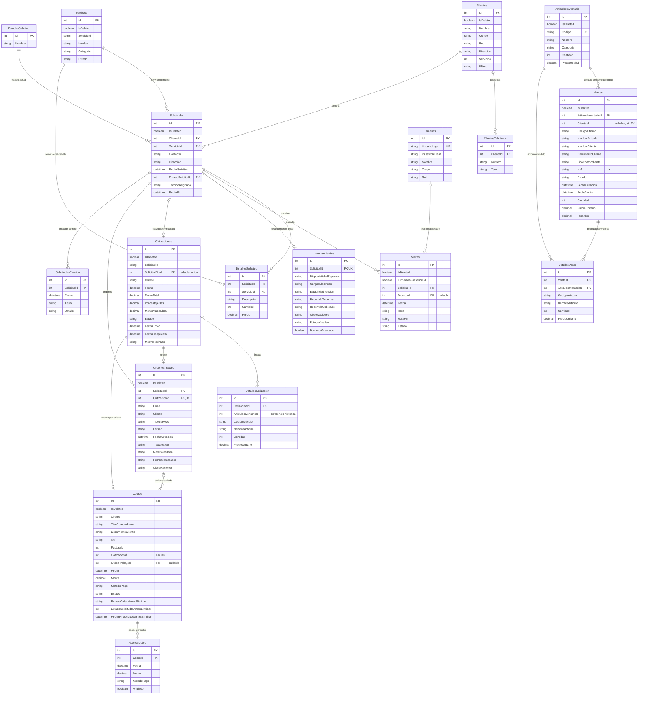

# ElectroGestion

[](#version-210)
[](https://electrogestion.runasp.net/)
[](https://dotnet.microsoft.com/)
[](https://www.microsoft.com/sql-server)

> 🚀 **Enlace Principal de Despliegue (Producción):** [https://electrogestion.runasp.net/](https://electrogestion.runasp.net/)

Sistema de gestión operativa y comercial para empresas de ingeniería eléctrica, contratistas e instalaciones de energía. Centraliza el ciclo de atención y venta: solicitudes, visitas, levantamientos, cotizaciones, órdenes de trabajo, cobros, facturas, ventas directas, clientes, inventario e informes.

---

## 🌐 Despliegue en Producción

El sistema se encuentra desplegado y plenamente operativo en la nube a través de MonsterASP.net:

- **Enlace de Producción:** [https://electrogestion.runasp.net/](https://electrogestion.runasp.net/)
- **Plataforma:** ASP.NET Core Blazor (.NET 10) Server Components
- **Base de Datos:** Microsoft SQL Server

### Sesiones y despliegue

El acceso usa una cookie de sesión firmada por el servidor. Al refrescar se recupera el usuario; al cerrar sesión se elimina la cookie. La sesión vence tras 30 minutos sin actividad. En localhost funciona por HTTP y en producción debe servirse por HTTPS.

Las claves de protección se guardan por defecto en el directorio de datos locales del usuario que ejecuta la aplicación (`ElectroGestion/keys`). En el hosting configure `DataProtection__KeysPath` con una carpeta persistente y escribible; si hay varias instancias, todas deben compartir esa carpeta. Configure también `ConnectionStrings__SqlConStr` para la base de datos del hosting y los encabezados de proxy de HTTPS si el servidor web termina TLS antes de ASP.NET Core.

### Credenciales de demostración

La migración crea estos usuarios para iniciar sesión. Las contraseñas se almacenan como hashes:

| Rol | Usuario | Contraseña |
| :--- | :--- | :--- |
| Gerente (Ana Hernández) | `ana` | `ana` |
| Técnico (Luis Peña) | `luis` | `luis` |
| Técnico (Carlos Méndez) | `carlos` | `carlos` |
| Administrador (Recuperación) | `admin` | `admin` |

Estas credenciales son únicamente para demostración; deben cambiarse antes de usar el sistema en producción.

## Versión 2.1.0

Esta versión agrupa la ampliación del flujo operativo y comercial, los reportes y la recuperación segura de registros. La versión anterior era `2.0.4`.

### Funcionalidades incluidas

- **Acceso y perfiles:** inicio y cierre de sesión con cookie protegida, persistencia al actualizar la página y vencimiento por inactividad. Los perfiles Gerente, Técnico y Administrador de recuperación tienen permisos distintos.
- **Inicio:** indicadores globales para Gerencia e indicadores relacionados con el técnico conectado.
- **Solicitudes:** alta, consulta, edición y filtros aplicados con el botón **Buscar**. Estados: **Pendiente**, **En proceso**, **En Espera Administración**, **En revisión**, **Enviada al cliente**, **Aprobada**, **Rechazada**, **Pendiente de cobro**, **Finalizada** y **Cancelada**. El Gerente puede seleccionar y eliminar varias solicitudes; los registros se pueden restaurar desde Recuperación.
- **Agenda:** calendario de visitas, asignación de técnico, validación de horarios y cambios de fecha, estado o visita.
- **Levantamientos:** captura de información técnica, observaciones y fotografías por solicitud.
- **Cotizaciones:** creación desde levantamientos enviados a Administración; productos del inventario y cantidades, mano de obra, subtotal, ITBIS del 18 %, total y condiciones de pago. Incluye estados **En revisión**, **Enviada al cliente**, **Aprobada** y **Rechazada**, seguimiento, detalle e impresión o guardado PDF con logo y firmas.
- **Órdenes de trabajo:** checklist, materiales vinculados a la cotización, herramientas asignadas e instrucciones de campo. Gerencia administra las órdenes; el Técnico consulta sus órdenes y puede marcarlas listas para cobro. La cotización vinculada solo está disponible para Gerencia.
- **Cobros:** creación desde una cotización aprobada, comprobante de consumidor final o crédito fiscal, abonos parciales con método de pago, edición/eliminación de abonos, saldo, finalización, reversión, eliminación e impresión de factura. El NCF `DEMO` se genera para demostración y no es una secuencia fiscal autorizada.
- **Clientes:** consulta y administración de datos del cliente y su actividad. Gerencia puede crear, editar y eliminar; el Técnico cuenta con consulta.
- **Historial:** solicitudes finalizadas ordenadas por actividad reciente y línea de tiempo resumida con los eventos de solicitud, visita, levantamiento, cotización, orden y cobro.
- **Ventas directas:** ventas de uno o varios productos con stock, borradores, comprobante de consumidor final o crédito fiscal, cálculo automático de ITBIS del 18 %, NCF de demostración e impresión de factura. Los NCF de prueba no son secuencias fiscales autorizadas.
- **Servicios:** catálogo con categoría y estado activo/inactivo. Los servicios inactivos no están disponibles para nuevas solicitudes. El precio se define en los productos de inventario y en la mano de obra de la cotización, no en el catálogo de servicios.
- **Inventario:** catálogo de artículos, filtros por ID, código, nombre, categoría, disponibilidad y rango de precio; detalle y acción para agregar stock.
- **Proveedores:** consulta, alta, edición, filtros y eliminación individual o múltiple con confirmación.
- **Reportes:** consumo de materiales en servicios durante el último año y ventas directas durante los últimos tres meses, con filtros, indicadores, tablas y gráficos.
- **Filtros y protección de datos:** la mayoría de los listados requiere pulsar **Buscar** para aplicar criterios. Las bajas lógicas conservan los registros eliminados y el Administrador puede recuperarlos.

### Funcionalidades aún no incluidas

Los reportes de rendimiento de técnicos y reportes financieros adicionales aparecen como opciones futuras. La sección de proveedores se administra en el estado de la aplicación y todavía no forma parte del esquema relacional de SQL Server.

---

## Sustentado por

| Nombre | Matrícula |
| :--- | :--- |
| **Jeison Amparo Abreu** | 1000-5296 |
| **Dionicio Hernández Pujols** | 1000-5331 |
| **Julymar Santos Balbi** | 1000-5890 |
| **Isaac Rosario Paulino** | 2023-0532 |
| **Williams Rafael Sanchez Acosta** | 2023-0136 |

**Carrera:** Ingeniería en Sistemas y Computación  
**Asignatura:** Proyecto Aplicado  

---

## Descripción del Proyecto

ElectroGestion centraliza las operaciones entre la administración y los técnicos de campo. Sustituye el manejo informal de órdenes de trabajo por un flujo estructurado que garantiza trazabilidad desde la primera llamada del cliente hasta la finalización del servicio.

### Roles del Sistema

- **Gerencia (Administración):**
  - Vista global de solicitudes, agenda, levantamientos, cotizaciones, órdenes, cobros, clientes, historial, ventas, servicios, inventario, proveedores y reportes.
  - Administración del ciclo de cotización, orden y cobro; creación e impresión de facturas y registro de ventas directas.
  - Administración de clientes, servicios, inventario y proveedores. Puede eliminar solicitudes y otros registros donde la pantalla lo permita.
  - Acceso a informes globales de consumo de materiales y ventas.

- **Técnico (Campo):**
  - Consulta de solicitudes, visitas, órdenes asignadas, clientes e historial.
  - Registro de levantamientos técnicos con información y fotografías.
  - Puede marcar una orden como lista para cobro tras confirmar su finalización.
  - No puede eliminar solicitudes, administrar órdenes, ver cotizaciones vinculadas, crear cobros o acceder a ventas, servicios, inventario, proveedores ni reportes.

- **Administrador de recuperación:**
  - Acceso al módulo interno de recuperación para restaurar registros eliminados lógicamente.
  - No corresponde al rol de Gerente ni aparece como una opción operativa del menú lateral.

---

## Arquitectura y Tecnologías

El sistema está desarrollado sobre la plataforma .NET utilizando una arquitectura por capas orientada a servicios:

- **Framework:** .NET 10 (C#)
- **Interfaz de Usuario:** ASP.NET Core Blazor (Interactive Server Components)
- **Persistencia de Datos:** Entity Framework Core 10 (Code-First)
- **Base de Datos:** Microsoft SQL Server / SQL Server Express
- **Componentes UI:** Blazor Bootstrap + diseño CSS estructurado
- **Inyección de Dependencias:** `IDbContextFactory<Contexto>` para manejo seguro de contextos asíncronos en Blazor Server

---

## Modelo de Base de Datos

El diagrama representa las entidades y relaciones persistidas por `Contexto` y las migraciones de Entity Framework Core vigentes. Los nombres corresponden a las tablas derivadas de los `DbSet`. Las líneas reflejan claves foráneas configuradas en el modelo, no solo propiedades enteras con nombres de ID.



`Telefono`, `Telefono2`, `Subtotal`, `MontoPagado`, `SaldoPendiente`, `Estado` del inventario y otros valores calculados son propiedades no mapeadas y no aparecen como columnas. `ArticuloInventarioId` en `DetallesCotizacion` conserva el identificador junto al código, descripción y precio de ese momento; no tiene una FK configurada al inventario. `Ventas.ClienteId` tampoco tiene relación FK configurada. Los proveedores se almacenan actualmente en el estado de la aplicación, no en una tabla de SQL Server.

### Reglas de Integridad Referencial

- **Clientes a teléfonos:** cascada (`Cascade`).
- **Clientes, servicios y estados a solicitudes:** restricción (`Restrict`) mientras existan solicitudes relacionadas.
- **Solicitudes a detalles:** cascada (`Cascade`); el servicio de cada detalle se conserva con restricción (`Restrict`).
- **Solicitudes a visitas:** restricción física (`Restrict`); las eliminaciones del flujo se manejan mediante bajas lógicas.
- **Solicitudes a levantamientos:** relación uno a uno por `SolicitudId` único, con cascada (`Cascade`).
- **Solicitudes a cotizaciones:** relación opcional y única mediante `SolicitudDbId`; una solicitud puede no tener cotización o tener una.
- **Cotizaciones a detalles de cotización:** cascada (`Cascade`). Una cotización puede originar como máximo una orden y un cobro, debido a los índices únicos en `CotizacionId`.
- **Cobros a abonos:** cascada (`Cascade`). El cobro puede tener una orden asociada opcional.
- **Órdenes a cotizaciones y solicitudes:** restricción (`Restrict`) para proteger el flujo asociado.
- **Ventas y líneas de venta a inventario:** restricción (`Restrict`); las líneas de venta se eliminan en cascada al eliminar físicamente su venta.
- **Usuarios a visitas:** `TecnicoId` es opcional y queda nulo (`SetNull`) si se elimina el usuario.
- **Bajas lógicas:** clientes, servicios, inventario, solicitudes, visitas, cotizaciones, órdenes, cobros y ventas tienen `IsDeleted`. Los filtros globales de EF Core ocultan registros eliminados en consultas normales y el módulo de Recuperación permite restaurarlos.

---

## Configuración y Ejecución Local

### 1. Requisitos Previos
- [.NET 10 SDK](https://dotnet.microsoft.com/) instalado.
- Instancia activa de SQL Server (SQL Express, LocalDB o SQL Server estándar).
- Herramienta de línea de comandos de EF Core (`dotnet tool install --global dotnet-ef`).

### 2. Clonar el Repositorio
```bash
git clone https://github.com/Je1sonAmparo/ElectroGestion.git
cd ElectroGestion
```

### 3. Configurar Cadena de Conexión
Verificar el archivo `appsettings.json` en la raíz del proyecto y ajustar la cadena según su servidor local:

```json
{
  "ConnectionStrings": {
    "SqlConStr": "Server=.\\SQLExpress;Database=ElectroGestionDB;Trusted_Connection=True;TrustServerCertificate=true;"
  }
}
```

### 4. Aplicar Migraciones
Ejecutar el comando de Entity Framework para crear la base de datos y sembrar los datos iniciales de prueba:

```bash
dotnet ef database update
```

### 5. Iniciar la Aplicación
```bash
dotnet run
```
O con recarga en vivo para desarrollo:
```bash
dotnet watch
```

La aplicación iniciará en `https://localhost:7198` (o el puerto configurado en `Properties/launchSettings.json`).
