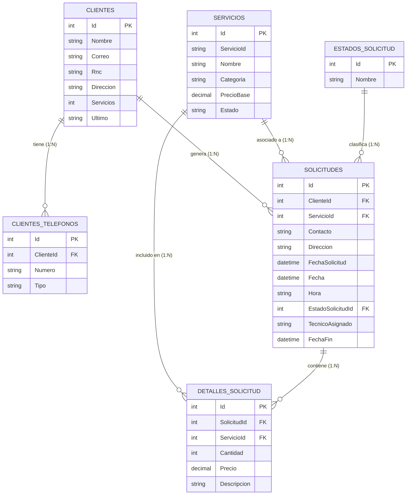

# ElectroGestion

Sistema de gestión operativa y comercial para empresas de ingeniería eléctrica, contratistas e instalaciones de energía. Permite administrar el ciclo completo de atención: registro de clientes, catálogo de servicios, gestión de solicitudes técnicas y asignación de trabajos en campo.

---

## Sustentado por

| Nombre | Matrícula |
| :--- | :--- |
| **Jeison Amparo Abreu** | 1000-5296 |
| **Dionicio Hernández Pujols** | 1000-5331 |
| **Julymar Santos Balbi** | 1000-5890 |
| **Isaac Rosario Paulino** | 2023-0532 |
| **Williams Rafael Sanchez Acosta** | 2023-0136 |

**Carrera:** Ingeniería en Sistemas y Computación  
**Asignatura:** Proyecto Aplicado  

---

## Descripción del Proyecto

ElectroGestion centraliza las operaciones entre la administración y los técnicos de campo. Sustituye el manejo informal de órdenes de trabajo por un flujo estructurado que garantiza trazabilidad desde la primera llamada del cliente hasta la finalización del servicio.

### Roles del Sistema

- **Gerencia (Administración):**
  - Supervisión global de solicitudes, órdenes de trabajo y cobros.
  - Gestión completa (CRUD) de clientes y catálogo de servicios con precios base.
  - Asignación de prioridades y seguimiento del estado operativo.
  - Reportes de facturación, servicios realizados y volumen por cliente.

- **Técnico (Campo):**
  - Consulta de agenda operativa y solicitudes asignadas.
  - Registro de datos de levantamiento técnico (cargas eléctricas, tensión, metraje de tuberías y cableado).
  - Consulta de clientes y especificaciones de las visitas programadas.
  - Acceso restringido a funciones críticas (no eliminación de registros sensibles).

---

## Arquitectura y Tecnologías

El sistema está desarrollado sobre la plataforma .NET utilizando una arquitectura por capas orientada a servicios:

- **Framework:** .NET 10 (C#)
- **Interfaz de Usuario:** ASP.NET Core Blazor (Interactive Server Components)
- **Persistencia de Datos:** Entity Framework Core 10 (Code-First)
- **Base de Datos:** Microsoft SQL Server / SQL Server Express
- **Componentes UI:** Blazor Bootstrap + diseño CSS estructurado
- **Inyección de Dependencias:** `IDbContextFactory<Contexto>` para manejo seguro de contextos asíncronos en Blazor Server

---

## Modelo de Base de Datos

La base de datos se encuentra normalizada (3FN). La estructura contempla la separación de números de contacto mediante la entidad `ClientesTelefonos`, catálogos para estados de solicitud y detalles desagregados de servicios por solicitud.



### Reglas de Integridad Referencial
- **Clientes a Teléfonos:** Cascada (`Cascade`). Al eliminar un cliente, se eliminan sus teléfonos de contacto.
- **Clientes / Servicios a Solicitudes:** Restricción (`Restrict`). No es posible eliminar un cliente o un servicio que tenga solicitudes registradas.
- **Solicitudes a Detalles:** Cascada (`Cascade`). Al remover una solicitud, se eliminan sus renglones de detalle.

---

## Configuración y Ejecución Local

### 1. Requisitos Previos
- [.NET 10 SDK](https://dotnet.microsoft.com/) instalado.
- Instancia activa de SQL Server (SQL Express, LocalDB o SQL Server estándar).
- Herramienta de línea de comandos de EF Core (`dotnet tool install --global dotnet-ef`).

### 2. Clonar el Repositorio
```bash
git clone https://github.com/Je1sonAmparo/ElectroGestion.git
cd ElectroGestion
```

### 3. Configurar Cadena de Conexión
Verificar el archivo `appsettings.json` en la raíz del proyecto y ajustar la cadena según su servidor local:

```json
{
  "ConnectionStrings": {
    "SqlConStr": "Server=.\\SQLExpress;Database=ElectroGestionDB;Trusted_Connection=True;TrustServerCertificate=true;"
  }
}
```

### 4. Aplicar Migraciones
Ejecutar el comando de Entity Framework para crear la base de datos y sembrar los datos iniciales de prueba:

```bash
dotnet ef database update
```

### 5. Iniciar la Aplicación
```bash
dotnet run
```
O con recarga en vivo para desarrollo:
```bash
dotnet watch
```

La aplicación iniciará en `https://localhost:7198` (o el puerto configurado en `Properties/launchSettings.json`).

---

## Verificación Automatizada del CRUD

El proyecto incluye un módulo de pruebas directas contra la base de datos configurada para validar las operaciones de inserción, lectura, actualización y restricciones de borrado de Clientes, Servicios y Solicitudes:

```bash
dotnet run --environment Development -- --test-crud
```